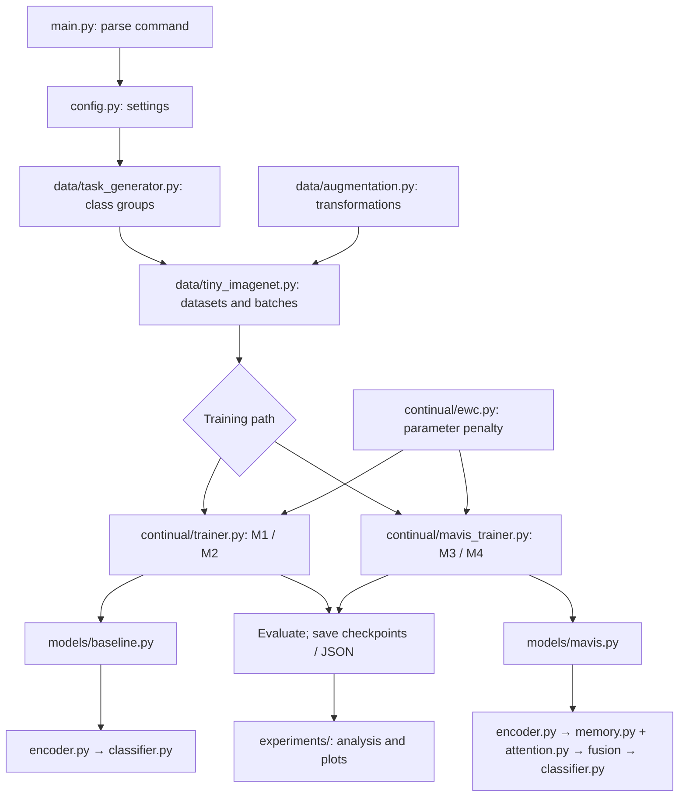

# MAVIS: Complete Codebase and Project Flow Walkthrough

Reviewed on October 28, 2026.

**MAVIS is a research system that learns new image categories in stages while trying to preserve what it learned earlier.** Its core challenge is **catastrophic forgetting**: learning new classes can overwrite the knowledge needed to recognize old ones.

The review covered the project's 32 Python files, configuration and launch scripts, saved results, and supporting documentation. The Bayesian-routing test and all nine review sanity checks passed. Models were not retrained, and not every binary checkpoint or reference-PDF page was inspected. This walkthrough follows executable code; some existing documentation describes older versions.

## 1. The problem MAVIS solves

Imagine teaching a student to recognize 200 object types, but teaching only 20 new types at a time. After each lesson, test everything taught so far:

```text
Learn Task 1: 20 classes → Test those 20 classes
Learn Task 2: 20 additional classes → Test all 40 classes
...
Learn Task 10: final 20 classes → Test all 200 classes
```

This is **class-incremental continual learning**:

- **Class-incremental:** the set of recognizable classes grows.
- **Continual learning:** the same model learns sequentially.
- **Catastrophic forgetting:** performance on earlier classes deteriorates.
- **Stability–plasticity trade-off:** preserving old knowledge competes with adapting to new knowledge.

The default dataset is **Tiny ImageNet**, with 200 classes and RGB images of size `64 × 64`.

MAVIS combines a **CNN encoder**, **prototype memory bank**, **multi-head attention**, **gated fusion**, **knowledge distillation**, **feature replay**, and **Online EWC**. It is substantially richer than “CNN + memory + EWC.”

## 2. Overall file-to-file flow

The entry point is [`main.py`](../main.py).



Connections are either **function calls**, where one module imports and calls another, or **file-based handoffs**, where training saves files and analysis reads them. Plotting and statistical analysis do not participate in backpropagation.

## 3. Model variants and the two trainers

- **M1 — Baseline:** encoder + classifier.
- **M2 — EWC:** baseline architecture with an EWC training penalty.
- **M3 — MAVIS without EWC:** memory, attention, fusion, distillation, replay, and classifier finetuning.
- **M4 — Full MAVIS:** the M3 pipeline plus EWC.
- **M4noA — MAVIS without attention:** bypasses attention and fusion while retaining memory, replay, distillation, EWC, and memory-based evaluation.

An **ablation** removes a component to investigate its contribution. M3 is not simply M1 with attention attached: its training objective, learning-rate policy, replay, and evaluation also differ.

```text
M1 / M2:
main.py → models/baseline.py → continual/trainer.py

M3 / M4 / M4noA:
main.py → models/mavis.py → continual/mavis_trainer.py
```

The command determines the architecture. A YAML filename alone does not select it.

## 4. Command startup and configuration

```bash
python main.py train_mavis --seed 1 --tasks 10 --epochs 50
```

`main()` parses arguments with **argparse**, loads defaults or YAML settings, applies overrides, seeds Python/NumPy/PyTorch for training, and dispatches to a command function.

Commands:

- `setup`: check PyTorch/CUDA and attempt dataset setup.
- `verify`: currently calls the same setup function.
- `config`: print settings.
- `visualize`: save task example images.
- `train_baseline`: M1.
- `train_ewc`: M2.
- `train_mavis`: a MAVIS variant.

Overrides include `--epochs`, `--tasks`, `--width`, `--batch-size`, `--seed`, `--ewc-lambda`, `--no-ewc`, `--no-attention`, `--tag`, and `--fresh`. A **run tag** separates output filenames and checkpoint directories.

[`config.py`](../config.py) uses **dataclasses**, typed containers grouping dataset, training, encoder, memory, and other settings.

Defaults include 10 tasks, 20 classes/task, batch size 128, 50 epochs/task, learning rate `0.008`, feature dimension 512, encoder base width 128, 10 prototypes/class, four attention heads, and EWC strength `5000` with decay `0.88`.

An **epoch** traverses the current task's training dataset once. A **batch** is the smaller group processed in one training step.

## 5. Data pipeline: image files to batches

### Download and organization

[`data/download.py`](../data/download.py) downloads/extracts the archive and reorganizes validation images:

```text
tiny-imagenet-200/
  train/<class_wordnet_id>/images/<image>.JPEG
  val/<class_wordnet_id>/images/<image>.JPEG
```

### Task generation

[`data/task_generator.py`](../data/task_generator.py) discovers class folders, sorts their names, shuffles indices using the dataset seed, and divides them into groups of 20.

Two seed roles differ:

- `dataset.seed`: class ordering and task membership.
- Training seed: initialization and training randomness.

`--seed` changes the training seed, not the dataset class-order seed.

[`configs/task_definitions.json`](../configs/task_definitions.json) records the split. Training reconstructs it with `TaskGenerator` rather than loading that JSON as its source of truth.

### Loading and caching

[`data/tiny_imagenet.py`](../data/tiny_imagenet.py) defines `TinyImageNetTaskDataset` for individual images/labels and `TinyImageNetLoader` for PyTorch **DataLoaders**, which assemble batches.

It uses decoded-image caching, disk `.npy` RGB-pixel caches, memory mapping for existing caches, and a per-task dataset-object cache. `num_workers=0` forces loading into the main process, an intentional workaround for documented cluster multiprocessing failures.

### Augmentation

[`data/augmentation.py`](../data/augmentation.py) can apply random crops, flips, rotation, color jitter, and erasing. These **data augmentations** encourage recognition under varied appearances.

Images become **tensors**, multidimensional numerical arrays, and are normalized using ImageNet channel statistics. Validation uses tensor conversion and normalization without random augmentation.

```text
Images: [B, 3, 64, 64]
Labels: [B]
```

`B` is batch size; `3` represents RGB channels.

### Labels and indices

Task datasets return local labels `0–19`. Trainers convert them into cumulative model labels:

```text
absolute_label = local_label + task_id × 20

Task 1 local label 7 → model label 7
Task 2 local label 7 → model label 27
Task 3 local label 7 → model label 47
```

These labels follow shuffled task order, not the original alphabetical class indices. `TaskGenerator.get_task()` is 1-indexed; loaders and trainers are 0-indexed.

## 6. Encoder: pixels to representations

Both model families use [`models/encoder.py`](../models/encoder.py). `CNNEncoder` is a **ResNet-18-style convolutional neural network**, initialized from scratch.

```text
RGB image                  [B,    3, 64, 64]
Initial convolution        [B,  128, 64, 64]
Residual stage 1            [B,  128, 64, 64]
Residual stage 2            [B,  256, 32, 32]
Residual stage 3            [B,  512, 16, 16]
Residual stage 4            [B, 1024,  8,  8]
Global average pooling     [B, 1024,  1,  1]
Linear projection          [B,  512]
Layer normalization        [B,  512]
```

The final 512 numbers form a **feature vector**, **embedding**, or **latent representation**: a numerical description useful for distinguishing classes.

- **Convolution:** learns edges, textures, and shape combinations.
- **Residual connection:** adds learned changes to an earlier representation, helping gradients propagate.
- **GroupNorm:** normalizes channel groups without BatchNorm-style running statistics.
- **Squeeze-and-Excitation:** emphasizes useful feature channels.
- **ReLU:** introduces nonlinear behavior.
- **Global average pooling:** summarizes spatial feature maps.
- **LayerNorm:** normalizes the final feature vector.

No initial max-pooling layer is used, preserving information in small images. The last two spatial feature maps can also be returned for distillation.

## 7. Classifier: features to class scores

[`models/classifier.py`](../models/classifier.py) defines `CosineLinear` and `IncrementalClassifier`.

A **classifier head** maps features into class scores. It normalizes both input features and learned class weight vectors, then compares their directions using **cosine similarity**.

```text
Image feature direction
→ compare with each learned class direction
→ class scores
```

Scores are multiplied by `24`. These raw scores are **logits**; softmax converts them into probabilities.

MAVIS uses an **additive cosine margin**, default `0.20`, in supervised live-image training. It makes the correct class work harder to beat competitors, encouraging separation.

All 200 outputs are allocated from the start. No new neurons are physically added after a task. The trainer uses **logit masking/slicing** to determine which classes participate in a loss or prediction.

## 8. Memory, attention, and fusion

[`models/mavis.py`](../models/mavis.py) connects:

```text
Image → encoder → current feature
→ attention retrieves memory
→ fuse current and retrieved features
→ classifier → logits
```

A **forward pass** computes outputs; it does not by itself update weights.

### Memory bank

[`models/memory.py`](../models/memory.py) stores **prototypes**, representative class features. Multiple prototypes represent different visual groups within a class.

After each task, **K-means clustering** groups training features and produces 10 centers/class. Default tensor:

```text
[10 tasks, 20 classes, 10 prototypes, 512 features]
```

This holds 2,000 prototype vectors. Other buffers store per-class **diagonal variances**, populated-task flags, active-task running prototypes, and observation counts.

**Registered buffers** are saved in `state_dict` but are not trainable parameters updated by the optimizer.

Running prototypes use an **exponential moving average (EMA)**:

```text
updated prototype = 0.92 × old prototype + 0.08 × batch mean

Training retrieval:
completed-task prototypes + active-task running prototypes

Evaluation retrieval:
all completed-task prototypes
```

Comments saying training retrieves only past-task memory are outdated.

### Attention

[`models/attention.py`](../models/attention.py) implements **multi-head cross-attention**:

- **Query:** what the current image asks for.
- **Key:** how each stored prototype is matched.
- **Value:** information returned from matching memory.

```text
attention weights = softmax(QKᵀ / (√head_dimension × temperature))
retrieved feature = attention weights × V
```

Four heads divide 512 features into 128 dimensions/head. Each learns matching patterns. This is image-feature-to-memory attention, not a Vision Transformer over image patches.

FP32 and `torch.bmm` work around documented cluster compiler/backend failures. Query chunking bounds GPU memory usage. An empty bank returns a learned fallback embedding.

### Gated fusion

```text
raw_gate = sigmoid(linear(concatenate(current, retrieved)))
gate = 0.05 + 0.90 × raw_gate
fused = gate × current + (1 − gate) × retrieved
```

A **sigmoid** maps values between 0 and 1. The gate is 512-dimensional, not a single scalar. It starts at `0.5`, with effective range `0.05–0.95`.

`fuse_features()` accepts features directly so replay can bypass image encoding while using attention/fusion.

## 9. One training step and eight loss terms

[`continual/mavis_trainer.py`](../continual/mavis_trainer.py) orchestrates MAVIS training:

1. Move images/labels to CPU or GPU.
2. Convert local labels into cumulative model labels.
3. Clear old gradients.
4. Run `MAVIS.forward()`.
5. Update active-task running prototypes.
6. Calculate losses.
7. Run backpropagation.
8. Update parameters with AdamW.
9. Advance the learning-rate schedule when the optimizer step succeeds.

**Backpropagation** calculates how parameters contributed to the loss. An **optimizer** uses those gradients to adjust parameters.

The code uses **AdamW**, even though the configuration's optimizer string says `adam`. It also uses:

- **Automatic mixed precision:** selected GPU calculations use lower precision.
- **Gradient scaling:** protects small gradients from numerical problems.
- **OneCycleLR:** raises and lowers learning rates during a task.
- **Differential learning rates:** after Task 1, the encoder learns more slowly than attention, gate, and classifier.

The encoder learning-rate multiplier starts around `0.20` and gradually decreases toward `0.15`.

### 1. Task-masked cross-entropy

“Recognize the correct class among the current task's 20 classes.” Restricting the live-image loss avoids directly treating historical classes as negative examples.

### 2. Feature distillation

“Keep the new description reasonably close to what previous versions would have produced.” Frozen teachers are `E₀`, the encoder after Task 1, and `Eₜ₋₁`, the previous-task encoder. Feature directions are compared using cosine similarity.

### 3. PODNet-style spatial distillation

“Preserve useful spatial response patterns.” The last two feature maps are pooled along height and width, normalized, and compared with the previous encoder.

### 4. InfoNCE-style prototype alignment

“Move the image toward its own prototype and distinguish it from other current classes.” This **contrastive learning** objective uses similarity scores and cross-entropy.

### 5. Historical prototype repulsion

“Avoid placing new classes too close to easily confused old classes.” It focuses on up to 32 closest historical prototypes: **hard negatives**.

### 6. Attention reconstruction

“When queried with a stored prototype, retrieve a similar direction.” The target and retrieved output are normalized before mean-squared error comparison.

### 7. Gaussian feature replay

“Practice examples resembling old classes.” Gaussian noise shaped by stored variances is added to prototypes. The result is normalized, fused, and classified.

These are synthetic **features**, not generated images. Fusion runs under `no_grad`, so replay loss updates the classifier rather than the encoder or retrieval modules.

### 8. Online EWC

“Avoid changing parameters important to earlier tasks.”

```text
Total objective = classification
                + weighted feature distillation
                + weighted spatial distillation
                + weighted prototype alignment
                + weighted historical repulsion
                + attention reconstruction
                + weighted feature replay
                + EWC penalty
```

There are eight top-level terms. Counting the two distillation anchors separately can explain documents describing nine losses.

## 10. EWC: protection outside the forward path

[`continual/ewc.py`](../continual/ewc.py) implements **Online Elastic Weight Consolidation**.

Imagine parameters as adjustable dials. EWC estimates which are important and makes moving them more expensive. It stores a reference parameter snapshot, `θ*`, and importance estimate, `F`, a diagonal **Fisher information** approximation.

```text
EWC penalty = λ/2 × Σ Fᵢ × (θᵢ − θᵢ*)²

After each task:
running importance = γ × previous importance + new importance
reference parameters = current parameters
```

`λ` controls strength; `γ` controls decay of older importance. “Online” means one accumulated importance state rather than a separate full state per historical task.

EWC does not retrieve memory or directly modify inference. It affects predictions through learned weights.

The code squares gradients of batch-mean losses and averages them over batches. This is an approximate importance estimator, not a per-example Fisher calculation, and its scale depends on batching.

## 11. After finishing a task

Epoch completion is only part of a task:

```text
Finish live-image training
→ build current-task prototypes
→ rebuild past-task prototypes
→ call classifier alignment
→ balanced classifier finetuning
→ snapshot teacher encoders
→ update EWC importance
→ evaluate every seen task
→ save checkpoints and metrics
```

Later steps depend on earlier outputs.

### Build current memory

`MemoryBank.update_memory()` encodes training images, collects features by class, runs K-means, stores normalized prototypes, measures variance in normalized feature space, marks the task populated, and clears running prototypes.

### Rebuild historical memory

As the encoder changes, old prototype coordinates become stale: **representation drift**. The code reopens old tasks' training loaders and rebuilds prototypes with the current encoder.

**Historical training images are still required.** It re-encodes old images, rather than passing old feature vectors through the CNN.

The prototype tensor is bounded, but the overall protocol is not strictly “discard old images and retain only prototypes.” Training augmentation remains enabled during prototype construction, so variance includes augmentation effects.

### Balanced classifier finetuning

After Task 1, encoder, attention, and gate parameters are frozen. Only the classifier trains on Gaussian-perturbed prototypes from all seen classes. Defaults are 25 epochs and five draws/prototype.

This counters **recency bias**, the tendency to favor the newest classes.

### Teacher snapshots and EWC

The Task-1 encoder stays the long-term anchor. The just-completed encoder becomes the next task's previous-task teacher. EWC then updates parameter importance.

## 12. Four evaluation methods

`MAVISTrainer.evaluate_all_tasks()` predicts among **all classes seen so far**, without giving the model the true task identity.

### A. Classifier head

```text
image → encoder → attention/fusion → classifier scores
```

### B. NCM / prototype predictor

The code calls this **Nearest Class Mean**, but it is more precisely multi-prototype cosine matching:

```text
raw encoder feature
→ compare with every class prototype
→ best similarity among each class's 10 prototypes
→ strongest class
```

It uses raw encoder features, not fused features.

### C. Dynamic ensemble

Head and NCM scores become probabilities using separate temperatures. Recent classes get more classifier-head weight; older classes get more prototype-predictor weight. The mixture is normalized.

An **ensemble** combines predictors into one distribution.

### D. Hierarchical soft routing

It calculates:

1. Ensemble probability mass belonging to each task.
2. Image affinity to that task's best class-level prototype scores.
3. A mixture of these two task estimates.
4. Class probability conditional on its task.

```text
P(class) = task_weight × P(class | task)

P(class | task)
= ensemble_class_probability / ensemble_probability_mass_of_task
```

Division preserves relative class probabilities within each task. Routing is **soft**: every task contributes mass, rather than choosing one and discarding the rest.

**The primary saved MAVIS accuracy matrix uses hierarchical prediction.** Calling `model(image)` alone returns classifier logits, not the trainer's hierarchical inference output.

Top-1 and Top-5 are tracked for head, ensemble, and hierarchy. NCM has Top-1, and task-routing accuracy is tracked separately.

## 13. Metrics, checkpoints, and resume

An **accuracy matrix** records:

```text
After Task 1: [accuracy on Task 1]
After Task 2: [accuracy on Task 1, accuracy on Task 2]
After Task 3: [accuracy on Task 1, accuracy on Task 2, accuracy on Task 3]
```

Rows mean “after learning which task”; columns mean “accuracy on which task.”

[`evaluation/metrics.py`](../evaluation/metrics.py) provides:

- **Average accuracy:** mean of the final row.
- **Forgetting:** earlier best accuracy minus final accuracy, averaged over old tasks.
- **Backward transfer:** final old-task accuracy minus accuracy immediately after learning it.
- **Learning accuracy:** mean of the diagonal, measuring immediate acquisition.

```text
mavis_task_N.pth
mavis_ewc_task_N.pth
accuracy_matrix*.json
```

A **state_dict** stores parameters and registered buffers, including prototype memory.

`main.py` resumes from the highest completed MAVIS task and reconstructs frozen teachers. Boundaries:

- Resume is at task boundaries, not mid-epoch.
- Optimizer, scheduler, and random-generator states are not saved for exact continuation.
- Routing history and norm diagnostics are not fully restored.
- Baseline/EWC checkpoints have no equivalent automatic resume workflow.
- An already-completed MAVIS run is archived before starting another run.
- `--fresh` clears matching checkpoints in the selected directory.

Final summaries are written to `results/raw/`.

## 14. Remaining files and their roles

### Configuration

- [`configs/baseline.yaml`](../configs/baseline.yaml): EWC-disabled settings.
- [`configs/ewc.yaml`](../configs/ewc.yaml): EWC-enabled settings.
- [`configs/memory.yaml`](../configs/memory.yaml): EWC-disabled settings for the memory path.
- [`configs/mavis.yaml`](../configs/mavis.yaml): full-model settings.
- [`configs/task_definitions.json`](../configs/task_definitions.json): recorded task split.

The command selects the model/trainer implementation.

### Experiments

- [`experiments/run_factorial.py`](../experiments/run_factorial.py): launches five variants for selected seeds/settings as separate Python processes, saves logs, and skips existing final results.
- [`experiments/analyze_factorial.py`](../experiments/analyze_factorial.py): computes accuracy, forgetting, standard deviations, confidence intervals, paired comparisons, effect sizes, interaction terms, and approximate sample-size/power quantities.
- [`experiments/plot_factorial.py`](../experiments/plot_factorial.py): retention curves, summary charts, accuracy heatmaps, predictor comparisons, and retrieval diagnostics, with CSV companions.
- [`experiments/benchmark.py`](../experiments/benchmark.py): simpler comparison from legacy result filenames.

A **factorial experiment** systematically varies factors. The central grid varies EWC and the MAVIS memory pipeline; no-attention is an extra ablation.

### Evaluation visualization

- [`evaluation/visualize.py`](../evaluation/visualize.py): task sample grids and accuracy curves using Matplotlib's noninteractive backend.

### Cluster scripts

- [`scripts/run_phase5.sh`](../scripts/run_phase5.sh): SLURM job for full MAVIS.
- [`scripts/run_phase5_m3_ablation.sh`](../scripts/run_phase5_m3_ablation.sh): SLURM job without EWC.
- [`scripts/run_factorial.sh`](../scripts/run_factorial.sh): runs five variants across seeds sequentially, records failures, and invokes analysis.

**SLURM** is a cluster job scheduler. These scripts contain cluster-specific paths/resource requests.

The Python factorial runner passes `--fresh` for MAVIS variants; the shell runner does not. Interrupted-run behavior differs.

### Tests

- [`tests/test_hierarchical_bayes.py`](../tests/test_hierarchical_bayes.py): probability normalization and conditional-probability identity.
- [`tests/test_review_sanity.py`](../tests/test_review_sanity.py): nine checks for label arithmetic, attention bypass, seeding, EWC, feature norms, encoder width, replay noise, reconstruction normalization, and dropout consistency.
- [`tests/test_decode_cache.py`](../tests/test_decode_cache.py): cached/uncached pixel, label, and transformation equivalence.
- [`tests/test_gpu_speed.py`](../tests/test_gpu_speed.py): CPU/GPU matrix multiplication comparison.
- [`tests/__init__.py`](../tests/__init__.py): package marker.

The first two scripts passed during the review. Cache and GPU benchmark scripts were not run.

### Package initialization

The `__init__.py` files under [`data`](../data/__init__.py), [`models`](../models/__init__.py), [`continual`](../continual/__init__.py), [`evaluation`](../evaluation/__init__.py), and [`experiments`](../experiments/__init__.py) expose convenient imports. They do not define extra training stages.

### Dependencies and repository guidance

- [`requirements.txt`](../requirements.txt): PyTorch, torchvision, NumPy, Pillow, YAML, Matplotlib, and Markdown-rendering dependencies.
- [`.gitignore`](../.gitignore): excludes environments, datasets, checkpoints, caches, and generated files.
- [`README.md`](../README.md): introduction and setup guidance.
- [`CLAUDE.md`](../CLAUDE.md): repository guidance for coding assistants.
- [`PROJECT_LOG.md`](../PROJECT_LOG.md): historical decisions, changes, and experiment reports.

### Documentation and references

- [`docs/MAVIS_ARCHITECTURAL_FLOW_DIAGRAM.md`](../docs/MAVIS_ARCHITECTURAL_FLOW_DIAGRAM.md): detailed diagrams and explanations.
- [`docs/MAVIS_WHITEBOARD_BLUEPRINT.md`](../docs/MAVIS_WHITEBOARD_BLUEPRINT.md): visual presentation blueprint.
- [`docs/MAVIS_MASTER_ARCHITECTURAL_TREATISE.md`](../docs/MAVIS_MASTER_ARCHITECTURAL_TREATISE.md): architecture and mathematical discussion.
- [`docs/MAVIS_MASTER_ARCHITECTURAL_TREATISE.tex`](../docs/MAVIS_MASTER_ARCHITECTURAL_TREATISE.tex): LaTeX report source.
- [`docs/MAVIS_REVIEW_WALKTHROUGH.md`](../docs/MAVIS_REVIEW_WALKTHROUGH.md): earlier execution-order walkthrough.
- [`docs/MAVIS_REVIEW_WALKTHROUGH.tex`](../docs/MAVIS_REVIEW_WALKTHROUGH.tex): LaTeX counterpart.
- [`docs/REVIEW_LOG_2026-10-25.md`](../docs/REVIEW_LOG_2026-10-25.md): review findings and recorded fixes.
- [`docs/references/MAVIS Implementation.pdf`](<../docs/references/MAVIS Implementation.pdf>): supporting project reference.
- [`docs/references/kirkpatrick-et-al-2017-overcoming-catastrophic-forgetting-in-neural-networks.pdf`](../docs/references/kirkpatrick-et-al-2017-overcoming-catastrophic-forgetting-in-neural-networks.pdf): EWC reference paper.

These documents are not imported during training.

[`scripts/generate_chronicle_pdf.py`](../scripts/generate_chronicle_pdf.py) converts a Markdown chronicle into HTML and prints it using a headless browser. Its expected source, `MAVIS_COMPREHENSIVE_CHRONICLE.md`, is absent, so the utility is stale.

### Saved outputs

- `results/raw/published/`: older baseline, EWC, M3, and M4 results and historical environment metadata.
- `results/raw/prelim_w32_t5/`: preliminary width-32, five-task results.
- `results/raw/phase5_factorial/`: 15 result files covering five variants and three seeds.
- `results/archive/phase5_fac_w128_t10_e50_5x3/`: copies of those 15 results; verified byte-for-byte against raw copies during review.
- `phase5_w128_t10_results_backup.tar.gz`: compressed backup of that archive.
- `results/figures/task_samples.png`: generated example images.
- `results/figures/continual_accuracy_curves.png`: generated accuracy plot.
- Local `results/checkpoints/`: generated training state and metric histories.

The old `published/environment.json` describes TensorFlow-era metadata, not the current PyTorch environment.

## 15. Details to describe carefully

- **Historical images are revisited.** Prototype rebuilding depends on past training datasets.
- **The default is 10 prototypes/class.** Some comments still say three.
- **The encoder uses GroupNorm.** `use_batch_norm` does not change it.
- **Encoder width is configurable.** `base_width` is used; the old `channels` list is not.
- **Several settings are descriptive but unwired.** These include attention key/query/value dimensions, fusion dimension, memory capacity, mixup/cutmix, and smoke-test settings. Actual memory allocation derives from task count, classes/task, prototype count, and encoder feature dimension.
- **`--tasks` works.** Documentation saying only epochs can shorten a run is outdated.
- **M1/M2 and MAVIS train differently.** Baseline uses all 200 logits and smoothing `0.1`; MAVIS live-image training uses active-task logits and smoothing `0.02`. Both evaluate among seen classes.
- **`align_weights()` has no effective alignment action under normal initialization.** It sets an already-one scale buffer to ones.
- **K-means initialization uses evenly spaced samples.** The “K-means++ style” comment is imprecise.
- **Fresh dataset setup has a path mismatch.** `main.py` passes the dataset directory to a downloader that appends another `tiny-imagenet-200` component. An initial download can land one level deeper than expected.
- **Old results are historical evidence.** They do not automatically represent current code; improvements cannot be attributed to attention or EWC merely from an old headline comparison.

## 16. Recommended source-reading order

```text
main.py
→ config.py
→ data/task_generator.py
→ data/tiny_imagenet.py
→ data/augmentation.py
→ models/encoder.py
→ models/classifier.py
→ models/baseline.py
→ continual/trainer.py
→ models/memory.py
→ models/attention.py
→ models/mavis.py
→ continual/ewc.py
→ continual/mavis_trainer.py
→ evaluation/metrics.py
→ experiments/
```

Follow one batch through the model first, then one completed task through memory rebuilding and evaluation. Those two journeys explain nearly all of MAVIS's behavior.
