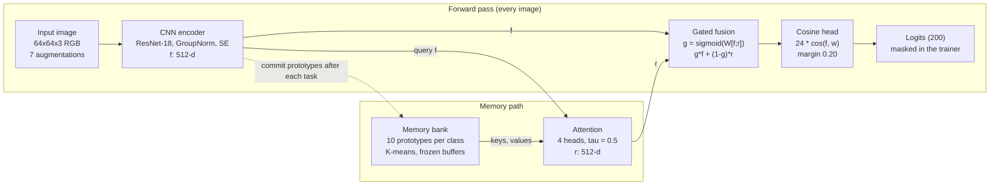
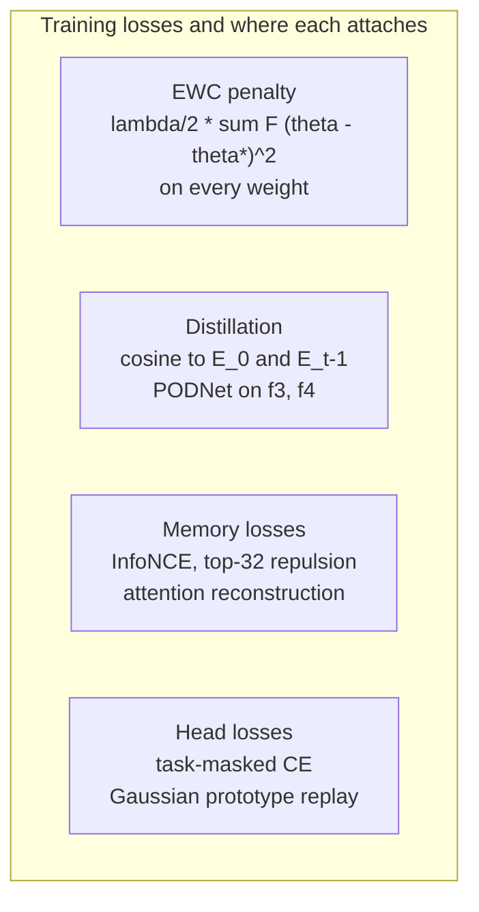

# MAVIS Review Walkthrough

**As of:** 2026-10-22

MAVIS is a from-scratch PyTorch system for class-incremental learning on Tiny ImageNet (200 classes, 64 x 64 pixels, 10 sequential tasks of 20 classes). It combines a non-parametric prototype memory retrieved by attention with Online Elastic Weight Consolidation, and the full model (M4) reaches 22.24% top-1 and 49.26% top-5 across all 200 classes with 12.50% memory forgetting, against 12.62% top-1 and 64.76% forgetting for the naive baseline. This walkthrough follows the code in execution order, top to bottom, and ends with the experiment history and a glossary.

## Contents

1. [Problem setup and terminology](#problem-setup-and-terminology)
2. [At a glance](#at-a-glance)
3. [Step 1. Entry point and configuration](#step-1-entry-point-and-configuration)
4. [Step 2. Data pipeline](#step-2-data-pipeline)
5. [Step 3. CNN encoder backbone](#step-3-cnn-encoder-backbone)
6. [Step 4. Cosine classifier head](#step-4-cosine-classifier-head)
7. [Step 5. Multi-prototype memory bank](#step-5-multi-prototype-memory-bank)
8. [Step 6. Attention retrieval and gated fusion](#step-6-attention-retrieval-and-gated-fusion)
9. [Step 7. Online Elastic Weight Consolidation](#step-7-online-elastic-weight-consolidation)
10. [Step 8. Baseline and EWC training loop (M1, M2)](#step-8-baseline-and-ewc-training-loop-m1-m2)
11. [Step 9. MAVIS training loop (M3, M4)](#step-9-mavis-training-loop-m3-m4)
12. [Step 10. Post-task pipeline](#step-10-post-task-pipeline)
13. [Step 11. Evaluation, checkpoints, and resume](#step-11-evaluation-checkpoints-and-resume)
14. [Experiment chronology](#experiment-chronology)
15. [Final results and the synergy argument](#final-results-and-the-synergy-argument)
16. [Hyperparameter compendium](#hyperparameter-compendium)
17. [Glossary and likely reviewer questions](#glossary-and-likely-reviewer-questions)
18. [Where everything else lives](#where-everything-else-lives)

---

## Problem setup and terminology

MAVIS solves class-incremental learning (CIL): 200 Tiny ImageNet classes arrive as 10 tasks of 20 classes, and at test time the model must pick the right class among every class seen so far with no task label given. This is the hardest continual-learning setting, because one shared 200-way head must separate classes it never saw together in a batch.

**Catastrophic forgetting** is the failure mode being fought. Gradient descent on task t overwrites the weights that encoded tasks 1 to t-1. The naive baseline (M1) learns each task to roughly 75% and then drops Task 1 to near 0% by the end of Task 10, with 64.76% average forgetting.

**Stability versus plasticity** is the trade-off every design choice balances. Stability means old tasks are preserved. Plasticity means new tasks are still learned well. Freezing everything gives stability and no plasticity. Training freely gives the opposite.

**Two levels of retention** are combined, and this is the thesis of the project:

- Parameter level: Elastic Weight Consolidation (EWC) adds a quadratic penalty to the loss on weights that mattered for earlier tasks. It never appears in the forward pass.
- Representation level: an external memory bank stores prototype feature vectors of old classes, multi-head attention retrieves from it, and a gated fusion blends retrieved memory into the live feature. This lives inside the forward pass.

**The four models** form a 2 x 2 factorial design so that each mechanism can be credited separately:

| Model | Parameter regularization | External memory | Code path |
| --- | --- | --- | --- |
| M1 Baseline CNN | none | none | `BaselineCNN` + `ContinualTrainer`, `train_baseline` |
| M2 CNN + EWC | Online EWC | none | `BaselineCNN` + `ContinualTrainer` with `ewc_lambda > 0`, `train_ewc` |
| M3 Memory only | none | memory bank + attention + fusion | `MAVIS` + `MAVISTrainer`, `train_mavis --no-ewc` |
| M4 Full MAVIS | Online EWC | memory bank + attention + fusion | `MAVIS` + `MAVISTrainer`, `train_mavis` |

**Dataset facts**: 100,000 training images (500 per class), 10,000 validation images (50 per class), 64 x 64 RGB, WordNet ids as folder names. No pretrained weights anywhere; the ResNet backbone is trained from random initialization on Task 1.

**The accuracy matrix** R is the central bookkeeping object. R[i][j] is the accuracy on task j measured right after finishing training on task i, so the matrix is lower triangular and grows one row per task. All four standard metrics are read off it:

$$\mathrm{ACC} = \frac{1}{T}\sum_{j=1}^{T} R_{T,j}$$

$$F = \frac{1}{T-1}\sum_{j=1}^{T-1}\Big(\max_{t \in \{j,\dots,T-1\}} R_{t,j} - R_{T,j}\Big)$$

$$\mathrm{BWT} = \frac{1}{T-1}\sum_{j=1}^{T-1}\big(R_{T,j} - R_{j,j}\big), \qquad \mathrm{LA} = \frac{1}{T}\sum_{j=1}^{T} R_{j,j}$$

ACC is final average accuracy. F is average forgetting (the drop from the best accuracy a task ever had to its final accuracy). BWT is backward transfer (negative means forgetting). LA is learning accuracy (how well each task was learned when it was new). The project reports ACC and F for every predictor, and also top-5 versions.

**Vocabulary that appears everywhere in the code**: `task_id` is 0-indexed in trainers and loaders but `TaskGenerator.get_task()` is 1-indexed. A local label is 0 to 19 inside a task; an absolute label is `task_id * 20 + local`. "Seen classes" means all classes from tasks 0 to the current one. "Active task" means the one being trained right now. A "prototype" is a stored 512-dimensional unit feature vector standing in for a class. E_0 is the encoder snapshot after Task 1, E_{t-1} is the snapshot after the previous task.

---

## At a glance

Memory sits in the forward pass; EWC sits only in the loss.

The top diagram is the forward pass every image takes. The memory path boxes are where the encoder's feature queries attention over frozen prototypes, and the retrieved vector is blended into the feature by a learned gate before the cosine head. The dashed line is the once-per-task commit of new prototypes. The bottom band lists the training losses by what they constrain; only the first is parameter-level, the rest act on features or the head.

---

## Step 1. Entry point and configuration

Everything starts in `main.py`, which parses one command, builds a config object, and dispatches to a training function. Before any import of the project it sets the environment variable `TRITON_DISABLE=1` (the HPC cluster's Triton compiler crashed on Python 3.14) and wraps stdout in a UTF-8 writer so Windows consoles do not crash on symbols.

**Commands and flags**:

| Command | What it does | Output |
| --- | --- | --- |
| `setup` / `verify` | checks PyTorch and CUDA, enables cuDNN benchmark, downloads the dataset if missing | console |
| `config` | prints the active config summary | console |
| `visualize` | renders 5 sample images for each of the 10 tasks | `results/figures/task_samples.png` |
| `train_baseline` | M1 | `results/raw/baseline_results.json`, checkpoints in `results/checkpoints/baseline` |
| `train_ewc` | M2 | `results/raw/ewc_results.json`, checkpoints in `results/checkpoints/ewc` |
| `train_mavis` | M4 (or M3 with `--no-ewc`) | `results/raw/mavis_results.json` or `mavis_m3_results.json`, checkpoints in `results/checkpoints/mavis` or `mavis_m3` |

Flags: `--config <yaml>` loads a YAML instead of defaults; `--epochs N` overrides epochs per task; `--ewc-lambda F` overrides the EWC strength; `--no-ewc` sets `config.ewc.enabled = False` (M3 ablation); `--fresh` deletes existing MAVIS checkpoints and starts at Task 1 instead of auto-resuming.

**Configuration** lives in `config.py` as nested Python dataclasses, assembled into one `MAVISConfig`. Each sub-config owns one concern:

| Dataclass | Owns |
| --- | --- |
| `DatasetConfig` | data path, 64 x 64 x 3, 200 classes, 20 classes per task, 10 tasks, seed 42 |
| `AugmentationConfig` | which augmentations are on and their strengths |
| `TrainingConfig` | batch size, epochs, learning rate, all loss weights, finetune settings |
| `EncoderConfig` | feature dimension 512, dropout 0.5 (the `channels` and `use_batch_norm` fields are not read by the encoder) |
| `ClassifierConfig` | 200 outputs, cosine margin 0.20 |
| `EWCConfig` | enabled flag, lambda 5000, 2000 Fisher samples, decay gamma 0.88 |
| `MemoryConfig` | capacity 2000, feature dim 512, 10 prototypes per class |
| `AttentionConfig` | 4 heads, temperature 0.5 (the key/query/value dim fields are not read; the attention uses 512 throughout) |
| `FusionConfig` | fusion dim 512 |

`MAVISConfig.save()` dumps to YAML and `MAVISConfig.load()` reads YAML back, silently dropping any key that is not a dataclass field and falling back to the project data directory when the serialized `data_dir` does not exist on the current machine. Running `python config.py` regenerates the four YAML files in `configs/`. The YAMLs are convenience snapshots; the dataclass defaults are the source of truth and are what the SLURM jobs used.

**Config to trainer hand-off**: `train_mavis` reads each loss weight from `config.training` with `getattr` defaults, builds the `MAVIS` model from the whole config, and passes the weights into `MAVISTrainer` as plain keyword arguments. The trainer never sees the config object.

---

## Step 2. Data pipeline

The pipeline turns the raw Tiny ImageNet zip into 10 deterministic per-task PyTorch DataLoaders whose labels are local 0 to 19. Four files do this in order.

**Download and layout** (`data/download.py`). The zip is fetched from the Stanford cs231n URL with a progress callback and extracted into `data/tiny-imagenet-200`. Training images already sit in `train/<wnid>/images/`. Validation images arrive flat with a `val_annotations.txt` mapping file, so `prepare_tiny_imagenet_val` moves each one into `val/<wnid>/images/` to mirror the training layout (with a retry loop for Windows file locks). `verify_dataset` counts classes and images and reads one sample's dimensions.

**Task generation** (`data/task_generator.py`). `TaskGenerator` lists the 200 WordNet folder names, sorts them so the global index of a class is stable, then draws a permutation of 0 to 199 with `numpy.random.RandomState(42)`. Consecutive slices of 20 become `TaskDefinition` objects (1-indexed `task_id`, global class indices, folder names). `validate()` asserts no overlap, 20 classes each, and full coverage. `save_definitions()` writes `configs/task_definitions.json` so the exact class order is recorded and reproducible. Every model (M1 to M4) sees the same class order because they all build the generator from the same seed.

**Dataset and loaders** (`data/tiny_imagenet.py`). `TinyImageNetTaskDataset` takes the list of folder names for one task and enumerates them; the label it returns is the position of the folder in that list, so labels are always 0 to 19 regardless of task. Every image of the task is decoded with PIL at construction time and held in RAM (about 120 MB per task). This preloading exists because multi-worker DataLoaders deadlocked on POSIX semaphores on the cluster's Python 3.14, so `num_workers` is hard-coded to 0 everywhere. `TinyImageNetLoader` builds a shuffled training loader and an unshuffled validation loader per task, batch size 128, `pin_memory=True`, and a cumulative validation loader that is defined but not used by the trainers.

**Augmentation** (`data/augmentation.py`). Training transforms run in this fixed order on 64 x 64 PIL images:

1. `RandomCrop(64, padding=4)`: zero-pad to 72 and crop back, a small translation.
2. `RandomHorizontalFlip()`.
3. `RandomRotation(10)`: rotate uniformly in [-10, +10] degrees.
4. `ColorJitter`: brightness, contrast, saturation each by factor 0.2, hue by 0.1.
5. `ToTensor()`: to a [0, 1] float tensor of shape 3 x 64 x 64.
6. `RandomErasing(p=0.25, scale=(0.02, 0.20), ratio=(0.3, 3.3), value=0)`: cutout of a random rectangle, 2% to 20% of the area.
7. `Normalize(mean=[0.485, 0.456, 0.406], std=[0.229, 0.224, 0.225])`: ImageNet statistics.

Evaluation uses only steps 5 and 7. `mixup` and `cutmix` flags exist in the config but are false and not implemented. The harsh 224-pixel AutoAugment policy was removed in Phase 4 because it destroyed detail at 64 pixels.

**Label offset convention**. Because datasets emit local labels, every trainer converts to absolute class ids with `targets + task_id * 20` before computing any loss or accuracy against the 200-way head, and converts back with `targets - start_cls` for task-local losses. This is the single most common source of bugs in the codebase and worth stating explicitly in a review.

---

## Step 3. CNN encoder backbone

`models/encoder.py` defines `CNNEncoder`, a ResNet-18-shaped network built from scratch for 64 x 64 inputs that maps an image to a 512-dimensional feature vector f. It is shared by every model; the baseline uses it with dropout 0 and MAVIS uses it with dropout 0.5.

**Stem**. A 3 x 3 convolution (3 to 128 channels, stride 1, no bias) followed by `GroupNorm(32, 128)` and ReLU. There is no 7 x 7 convolution and no initial max-pool, so the spatial size stays 64 x 64 into the first stage. Standard ImageNet ResNets would shrink 64 pixels to 16 before any residual block, which throws away most of the signal at this resolution.

**Residual block** (`BasicBlock`, expansion 1). Each block computes:

1. `conv3x3` then `GroupNorm(32)` then ReLU
2. `Dropout2d(p)` (whole channels dropped, p = 0.5 in MAVIS)
3. `conv3x3` then `GroupNorm(32)`
4. Squeeze-and-Excitation reweighting (below)
5. add the shortcut (identity, or a 1 x 1 stride-2 convolution plus GroupNorm when the shape changes)
6. ReLU

**Squeeze-and-Excitation** (`SEBlock`). Global average pool to one value per channel, a bottleneck `Linear(C, max(C/16, 8))` with ReLU, a `Linear(back to C)` with sigmoid, and the result multiplies every channel of the block output. This learns which channels matter for the current image, so it is a channel attention mechanism inside the backbone, distinct from the memory attention later.

**Stage dimensions** (two blocks per stage, stride on the first block of stages 2 to 4):

| Stage | Channels | Spatial | Used as |
| --- | --- | --- | --- |
| stem | 128 | 64 x 64 | |
| layer1 | 128 | 64 x 64 | |
| layer2 | 256 | 32 x 32 | |
| layer3 | 512 | 16 x 16 | f3, spatial distillation tap |
| layer4 | 1024 | 8 x 8 | f4, spatial distillation tap |
| head | 512 | 1 x 1 | f, the feature vector |

**Projection head**. `AdaptiveAvgPool2d(1)` then `Flatten` then `Linear(1024, 512)` then `LayerNorm(512)`. The LayerNorm keeps feature scale stable across tasks, which matters because so many later losses use cosine similarity on f. When called with `return_spatial=True` the encoder also returns the list `[f3, f4]` for the PODNet spatial distillation loss.

**Why GroupNorm instead of BatchNorm**. BatchNorm keeps running mean and variance estimated from the batches it sees. In continual learning every batch belongs to the active task, so those statistics drift to the newest classes and silently corrupt the features of older classes at evaluation time. GroupNorm normalizes 32 channel groups within each sample and keeps no cross-task state, so this contamination cannot happen. The README still says BatchNorm; the code uses GroupNorm everywhere.

**Every activation and normalization in the project**, for quick recall:

| Function | Where | Role |
| --- | --- | --- |
| ReLU | every conv block, SE bottleneck | non-linearity |
| Sigmoid | SE channel gate, fusion gate | squashes to (0, 1) for gating |
| Softmax | attention weights, every evaluation probability, InfoNCE, replay CE | turns scores into a distribution |
| GroupNorm(32) | all convolutions | batch-independent normalization |
| LayerNorm | encoder output, attention output | per-vector normalization |
| L2 normalization (`F.normalize`) | cosine classifier, prototypes, NCM, all contrastive losses | puts vectors on the unit sphere so dot product equals cosine |
| Dropout2d(0.5), Dropout(0.1) | residual blocks, attention weights | regularization |

The backbone has no tanh, GELU, or other activations.

---

## Step 4. Cosine classifier head

`models/classifier.py` maps the 512-dimensional feature to 200 logits with a cosine-similarity layer rather than a plain linear layer. The whole point is that every class weight has the same norm, so a newly trained task cannot win just by having bigger weights.

**CosineLinear**. The weight matrix W is 200 x 512 (Kaiming-uniform initialized). On every forward pass both the feature x and each weight row are L2-normalized, so their dot product is the cosine of the angle between them, bounded in [-1, 1]. That is multiplied by a fixed scale s = 24 so that softmax can become confident, and by a per-class `task_scale` buffer (all ones by default):

$$z_c = s \cdot \tau_c \cdot \cos\big(\hat{x}, \hat{w}_c\big), \qquad \hat{x} = \frac{x}{\lVert x \rVert}, \; \hat{w}_c = \frac{w_c}{\lVert w_c \rVert}$$

**Additive cosine margin** (m = 0.20, MAVIS only). During training, when targets are supplied, the cosine of the true class is reduced by m before scaling:

$$z_{y} = s \cdot \tau_y \cdot \big(\cos(\hat{x}, \hat{w}_y) - m\big)$$

This forces the feature to be at least an angular margin closer to its own class weight than to any other, which tightens intra-class clusters and widens inter-class gaps (the CosFace idea). The margin is only applied when `targets` is passed; the post-task balanced finetune deliberately passes `targets=None` so calibration is measured on the true cosine (Job 67 fix).

**Why cosine for continual learning**. With a plain linear head, AdamW weight decay shrinks weights that stop receiving gradient, which is exactly what happens to old-class weights once their task is over, and new-class weights grow large during their 50 epochs. That norm imbalance alone creates recency bias: the head predicts recent classes regardless of the feature. Normalizing removes the norm from the decision so only direction matters.

**Weight Aligning** (`align_weights`). The original WA method (CVPR 2020) rescales new-class weights by the ratio of old to new weight norms. On a cosine head that ratio is identically 1.0, so the method was reduced to its current form: after each task it sets `task_scale[:seen] = 1.0`, guaranteeing every seen class is scored at the same temperature. In practice this is a no-op safeguard, and the real anti-recency work moved to the balanced finetuning step.

**IncrementalClassifier** is a thin wrapper holding one `CosineLinear` with all 200 outputs from the start. The head never grows. Which logits count is decided outside, in the trainer, by slicing: `logits[:, start:end]` for the active task during training, `logits[:, :seen]` at evaluation. The baseline models use the same class with margin 0.

---

## Step 5. Multi-prototype memory bank

`models/memory.py` defines `MemoryBank`, the non-parametric half of MAVIS. It stores 10 unit-norm prototype vectors per class (2,000 entries of 512 floats, about 4 MB) plus a diagonal variance per class, and it is never touched by the optimizer.

**Tensor layout**. All state is registered buffers, so it travels inside `state_dict` and checkpoints but receives no gradient:

| Buffer | Shape | Holds |
| --- | --- | --- |
| `memory` | [10 tasks, 20 classes, K=10, 512] | locked prototypes |
| `is_populated` | [10] bool | which tasks have been committed |
| `class_variances` | [10, 20, 512] | per-class diagonal feature variance plus 1e-4 |
| `running_prototypes` | [20, 512] | EMA mean of the active task's classes, during training |
| `running_counts` | [20] | how many batches have updated each running prototype |

**Committing a task** (`update_memory`). After a task is trained, the encoder is put in eval mode and every training image of the task is encoded once under autocast. Features are grouped by class on the CPU, and for each class two things are computed: K = 10 centroids by a pure-PyTorch K-means (`kmeans_prototypes`: evenly spaced initial picks along the feature list, 10 iterations of `cdist`, `argmin`, and mean, then L2-normalize; if a class has fewer than K features they are repeated), and the biased diagonal variance of the raw features. Then `is_populated[task]` is set and the running prototypes are reset. Prototypes are built from training data only, never validation, to avoid leakage.

**Why K prototypes instead of one mean**. A single class mean collapses a multi-modal class (a dog from the front, the side, in snow) into one point that may sit in empty space. Ten sub-cluster centroids follow the real distribution, and nearest-class-mean scoring takes the best of the ten. K went 1 to 3 to 5 to 7 to 10 across the project, each step improving memory coverage.

**Running prototypes** (`update_running_prototypes`). During training of the active task, after every batch and without gradient, each class present in the batch updates its running vector with an exponential moving average, 0.92 old plus 0.08 batch mean. This exists so the attention module has valid keys for the current task from the first epoch, and so the InfoNCE prototype loss has targets, before the task has been committed.

**Retrieval APIs**, which define what the model is allowed to see when:

| Method | Returns | Used by |
| --- | --- | --- |
| `get_past_memories(t)` | prototypes of tasks < t, flattened [N x K, 512] | repulsion loss |
| `get_training_memories(t)` | past memories plus normalized running prototypes of task t | `MAVIS.forward` during training |
| `get_all_populated_memories()` | every committed prototype | `MAVIS.forward` at evaluation and `fuse_features` |
| `get_past_prototypes_and_labels(t)` | prototypes, absolute labels, and variances repeated per prototype for tasks < t | Gaussian replay loss |
| `get_mean_class_prototypes()` | mean over K per class | diagnostics |
| `compute_ncm_scores(f)` | cosine of f to every prototype, max over the K per class, shape [B, seen] | NCM predictor at evaluation |

**Nearest class mean (NCM)** is therefore a multi-prototype cosine classifier that needs no trainable weights:

$$s_{\mathrm{NCM}}(c) = \max_{k \in 1..K} \; \hat{f}^{\top} \hat{p}_{c,k}$$

**Gaussian covariance replay** uses the stored variance to synthesize pseudo-features of old classes without storing any images: a prototype plus Gaussian noise scaled by half the per-dimension standard deviation, then re-normalized. This gives the classifier head a cloud around each old class to train against, which is how cross-task discrimination is learned at zero image storage cost.

**Memory budget**. The method stores 2,000 vectors of 512 floats plus 200 variance vectors, no raw images, so it meets the fixed-memory constraint in the research question.

---

## Step 6. Attention retrieval and gated fusion

`models/attention.py` retrieves a memory-conditioned vector r for each live feature f, and `models/mavis.py` blends f and r with a learned gate before classification. This is the only place where the memory bank enters the forward data flow.

**ManualMultiHeadAttention**. A hand-written multi-head attention with embed dimension 512, 4 heads, head dimension 128, and four linear projections (query, key, value, output). It exists instead of `nn.MultiheadAttention` because the cluster's PyTorch tried to compile Triton FP16 kernels for 4-D matmuls and crashed, so the module forces FP32 inside an `autocast(enabled=False)` block and reshapes to 3-D so `torch.bmm` hits pre-compiled cuBLAS. Do not revert this.

The computation per head, with temperature tau = 0.5 sharpening the softmax:

$$Q = W_Q f, \quad K = W_K M, \quad V = W_V M, \qquad A = \mathrm{softmax}\!\left(\frac{Q K^{\top}}{\tau \sqrt{d_k}}\right), \qquad r = W_O \, (A V)$$

Here f is the live feature (one query token per image), M is the prototype matrix (N keys, up to 2,000 at Task 10), d_k = 128. Dividing by tau = 0.5 doubles the logits, which makes the attention distribution peakier. Without it, attending over hundreds of near-equidistant unit vectors averages them into a bland retrieved vector (entropy dispersion). Dropout 0.1 is applied to the attention weights during training.

**MemoryAttention** wraps the attention with three continual-learning specifics:

- The query is `f.unsqueeze(1)` (shape [B, 1, 512]) and the keys and values are the prototypes repeated per batch element ([B, N, 512]). `repeat` is used instead of `expand` because zero-stride tensors crashed the C++ SDPA backend.
- Task 1 has no past memory. Returning zeros would create a distribution shift between Task 1 and later tasks, so a learned `no_memory_embed` parameter (initialized at std 0.01) is returned instead.
- Queries are processed in chunks of 64 to bound the [B, N, 512] key tensor, which fixed a CUDA out-of-memory at Task 7 in Job 69.

The retrieved vector passes through `LayerNorm(512)` before fusion.

**Which memories are visible**. In `MAVIS.forward`, passing `task_id=t` during training retrieves from committed tasks below t plus the running prototypes of task t. Passing `task_id=None` at evaluation retrieves from every committed task. The model itself never masks logits; that is the trainer's job.

**Gated fusion**. The live feature and retrieved vector are concatenated into a 1,024-vector, passed through one `Linear(1024, 512)` and a sigmoid, and the result gates the blend per dimension:

$$g_{\mathrm{raw}} = \sigma\big(W_g [f ; r] + b_g\big), \qquad g = 0.05 + 0.90\, g_{\mathrm{raw}}, \qquad f_{\mathrm{fused}} = g \odot f + (1 - g) \odot r$$

The gate weights and bias are zero-initialized so the first forward pass is an exact 50/50 blend. The clamp to [0.05, 0.95] guarantees the memory path never fully switches off and the live path never fully dominates, which was found necessary for retrieval to keep mattering in late tasks. The gate is a single layer on purpose: a deeper gate overfit to the active task.

**fuse_features**. The same attention plus gate path, applied to prototype vectors instead of images and returning L2-normalized output, in chunks of 64. It is used so that replayed pseudo-features and finetuning inputs go through the exact transformation the head sees at evaluation time (feature distribution harmonization, Job 67 fix). Before this, the head was trained on raw prototypes but evaluated on fused features, a train/test mismatch.

**Parameters in the memory path**: four 512 x 512 projections, one LayerNorm, the 1 x 512 no-memory embedding, and the 1024 x 512 gate. These are all protected by EWC in M4 and all receive the full learning rate in every task.

---

## Step 7. Online Elastic Weight Consolidation

`continual/ewc.py` implements the parameter-level half of MAVIS. EWC treats the weights that mattered for old tasks as springs anchored at their old values, and the Fisher information decides how stiff each spring is. It is a loss term only; nothing about it exists in the forward pass.

**The idea** (Kirkpatrick et al., PNAS 2017). After training task A, the posterior over weights is approximated by a Gaussian centred at the trained weights with precision given by the diagonal Fisher information F. Training task B then minimizes its own loss plus a quadratic pull back toward the task-A weights, weighted by F, so weights that were important for A barely move and unimportant ones move freely.

**Diagonal Fisher** (`compute_fisher`). For each parameter, the Fisher is the expected squared gradient of the log-likelihood:

$$F_i = \mathbb{E}_{x,y}\left[\left(\frac{\partial \log p(y \mid x;\theta)}{\partial \theta_i}\right)^2\right]$$

Implementation: model in eval mode, iterate the finished task's training loader up to 2,000 samples, compute `log_softmax` over the seen classes only (logits sliced to `[:end_cls]`), `nll_loss` on the true labels, backpropagate, accumulate `grad ** 2` per parameter, and divide by the number of batches. Slicing to seen classes means classes not yet seen get exactly zero Fisher, so they keep full plasticity when their task arrives (Phase 5 fix). For MAVIS the model is called with `return_features=True` and the first output taken.

**Online variant** (`OnlineEWC`, Schwarz et al., ICML 2018). Rather than keeping one Fisher and one weight snapshot per past task (which would mean 9 penalties fighting each other by Task 10), a single running Fisher is kept and decayed:

$$F^{\mathrm{run}} \leftarrow \gamma\, F^{\mathrm{run}} + F^{\mathrm{new}}, \qquad \theta^{*} \leftarrow \theta \text{ (after the task)}$$

With gamma = 0.88, a task's curvature is weighted 0.88 to the power of 9, about 0.32, by Task 10. Early tasks are still protected but no longer freeze the network. The default gamma inside the class is 0.95; the MAVIS trainer passes 0.88 and the baseline trainer does not pass it, so M2 ran with 0.95.

**Penalty** (`penalty`), added to the loss on every batch once at least one task is complete:

$$\mathcal{L}_{\mathrm{EWC}} = \frac{\lambda}{2} \sum_i F^{\mathrm{run}}_i \big(\theta_i - \theta_i^{*}\big)^2$$

It loops over every parameter with `requires_grad`, so in MAVIS it covers the encoder, the attention projections, the fusion gate, and the cosine head. The memory bank is buffers, not parameters, so it is outside EWC by construction.

**Lambda calibration**. Standalone EWC (M2) used lambda = 50,000 because nothing else restrained the weights. In MAVIS the distillation terms already pull on the encoder, so lambda was set at 2,000 and then raised to 5,000 after Job 64 showed the penalty was only 2.8% of the total loss and not constraining anything; at 5,000 it contributes roughly 10% to 12% of the gradient magnitude.

**Persistence**. `state_dict()` and `load_state_dict()` serialize the running Fisher, the anchor weights, the task count, lambda, and gamma to `mavis_ewc_task_{t}.pth`, which is what makes resuming a MAVIS run after a cluster time limit exact.

**Known limitation, stated in the treatise**: the diagonal Fisher is only a local quadratic approximation at the anchor. Over 10 tasks the weight trajectory leaves that basin, which is why EWC alone (M2) gains only 0.54 points over the baseline and why the representation-level memory is needed.

---

## Step 8. Baseline and EWC training loop (M1, M2)

`continual/trainer.py` defines `ContinualTrainer`, the simple loop that produces the two reference points. It trains `BaselineCNN` (encoder plus cosine head, margin 0, dropout 0) one task at a time and records the accuracy matrix. M1 and M2 are the same code; M2 is M1 with `ewc_lambda > 0`.

**Per-task training**:

1. Fetch the task's training loader.
2. Build a fresh `AdamW` over all parameters, learning rate 0.008, weight decay 1e-2, and a `OneCycleLR` schedule over `epochs x steps_per_epoch` with default warm-up (30% rising, then annealing).
3. For each of the 50 epochs and each batch: offset labels to absolute ids, run the model under `torch.amp.autocast` (FP16), compute cross-entropy with label smoothing 0.1 over all 200 logits, add the EWC penalty if at least one task is complete, scale the loss with `GradScaler`, step, and step the scheduler only if the scaler did not skip the optimizer step (avoids a PyTorch warning about scheduler order).
4. After the epochs, if EWC is on, call `OnlineEWC.update` with the training loader and `fisher_samples` to refresh the running Fisher and snapshot the weights.

**Evaluation** (`evaluate_all_tasks`): put the model in eval mode, run every validation loader from task 0 to the current task, take the argmax over all 200 logits (not just seen classes), and append one row of per-task accuracies to the matrix. Save `model_task_{t}.pth`.

**Forgetting** (`compute_forgetting`): the standard formula from the first section over the matrix so far.

**Why the baseline collapses**, in terms of this loop. Cross-entropy over all 200 logits pushes every non-target logit down on every batch. During task t all targets belong to task t, so the 180 (or fewer) old-class logits receive only negative gradient for 50 epochs, and their cosine weights rotate away from any feature. Nothing restores them. In M2, EWC slows the rotation of important weights but cannot stop the head's old rows from being driven down, which is why M2's forgetting is still 65.39% and its gain is only 0.54 points. This observation is what motivated task-masked cross-entropy in the MAVIS trainer.

**Recorded settings for the logged runs**: M2 used lambda 50,000, 1,000 Fisher samples, gamma 0.95. The current `config.py` default lambda of 5,000 is tuned for M4, so re-running `train_ewc` with defaults does not reproduce the logged M2 numbers; pass `--ewc-lambda 50000`.

---

## Step 9. MAVIS training loop (M3, M4)

`continual/mavis_trainer.py` `MAVISTrainer.train_task` is the heart of the project. For one task it runs 50 epochs of a combined loss with up to eight terms, then hands off to the post-task pipeline in Step 10. M3 is this loop with the EWC term switched off.

**Differential learning rates**. `AdamW` with weight decay 1e-2 and four parameter groups: encoder, attention, fusion gate, classifier. On Task 1 every group uses the full rate 0.008 so the backbone can learn from scratch. On tasks 2 to 10 the encoder's rate is damped by a factor that decays gently with task index, `max(0.15, 0.20 - 0.007 x (task_id - 1))`, so 0.20 on Task 2 down to 0.15 by Task 9, while attention, gate, and head keep the full rate. The backbone is where old knowledge lives; the head and memory path are where new knowledge is most cheaply absorbed.

**Schedule**. `OneCycleLR` with `pct_start=0.15`, cosine annealing, `div_factor=10`, `final_div_factor=100`: a short 7-epoch ramp from 0.0008 to 0.008, then 43 epochs of cosine descent to 8e-6. This long descent is what got training accuracy above 90% on each task.

**Distillation warm-up**. For tasks after the first, the two distillation weights are multiplied by `alpha = min(1, 0.5 + 0.5 x epoch / 5)`, so distillation starts at half strength and reaches full strength at epoch 5. Early plasticity for the new classes, then the clamp tightens.

**Forward pass per batch**. The model is called with `task_id`, `targets` (for the cosine margin), and `return_spatials=True`, returning logits, the raw feature f, the fused feature, and `[f3, f4]`. Immediately after, the running prototypes are updated without gradient from f and the local labels.

**The loss terms**, with every weight and formula. Hats denote L2-normalized vectors, y the local label, B the batch:

| Term | Formula | Weight | What it protects or teaches |
| --- | --- | --- | --- |
| Task-masked CE | cross-entropy over the 20 active logits only, label smoothing 0.02, margin 0.20 on the true class | 1.0 | learns the new classes without sending negative gradient to old-class weights |
| Feature distillation | 0.5 (1 - cos(f, E_{t-1}(x))) + 0.5 (1 - cos(f, E_0(x))) | 3.0 x alpha | keeps the feature direction anchored to both the previous encoder and the Task-1 encoder, bounding cumulative drift |
| Spatial distillation (PODNet) | for f3 and f4: pool along width and along height, flatten, normalize, 1 - cos against the old encoder's maps, average | 1.5 x alpha | keeps where in the image the backbone looks, not just the final vector |
| Prototype InfoNCE | cross-entropy of (f-hat dot P-hat-transposed) / 0.20 over the running prototypes of the active task | 0.5 | pulls each feature toward its own class prototype and away from the other 19 |
| Top-32 memory repulsion | mean of relu(cos(f, p) - 0.20) squared over the 32 closest past prototypes | 2.0 | keeps new-class features out of the regions old classes occupy on the sphere |
| Attention reconstruction | MSE between attention(p, M) and p for up to 128 random past prototypes p | 1.0 | forces attention to return a prototype unchanged when queried with it, so retrieval stays faithful |
| Gaussian prototype replay | CE over seen classes on classifier(fuse_features(p + noise)) for 256 stratified prototypes | 2.0 | teaches the head to separate old classes from new without any stored images |
| Online EWC | lambda / 2 sum F (theta - theta-star) squared | lambda = 5000 (M4) or 0 (M3) | pins important weights of every module |

The total is the plain sum of the weighted terms:

$$\mathcal{L} = \mathcal{L}_{\mathrm{CE}} + \alpha_t \lambda_{\mathrm{dist}} \mathcal{L}_{\mathrm{dist}} + \alpha_t \lambda_{\mathrm{spat}} \mathcal{L}_{\mathrm{spat}} + \lambda_{\mathrm{proto}} \mathcal{L}_{\mathrm{proto}} + \lambda_{\mathrm{rep}} \mathcal{L}_{\mathrm{rep}} + \mathcal{L}_{\mathrm{recon}} + \lambda_{\mathrm{replay}} \mathcal{L}_{\mathrm{replay}} + \mathcal{L}_{\mathrm{EWC}}$$

The individual formulas, for recall:

$$\mathcal{L}_{\mathrm{dist}} = \tfrac{1}{2}\big(1 - \cos(f, E_{t-1}(x))\big) + \tfrac{1}{2}\big(1 - \cos(f, E_0(x))\big)$$

$$\mathcal{L}_{\mathrm{spat}} = \frac{1}{|S|}\sum_{s \in \{f_3, f_4\}} \tfrac{1}{2}\Big[\big(1 - \langle \widehat{\bar{s}^{W}}, \widehat{\bar{s}^{W}_{\mathrm{old}}} \rangle\big) + \big(1 - \langle \widehat{\bar{s}^{H}}, \widehat{\bar{s}^{H}_{\mathrm{old}}} \rangle\big)\Big]$$

$$\mathcal{L}_{\mathrm{proto}} = -\log \frac{\exp(\hat{f}^{\top}\hat{p}_y / 0.20)}{\sum_{c=1}^{20} \exp(\hat{f}^{\top}\hat{p}_c / 0.20)}$$

$$\mathcal{L}_{\mathrm{rep}} = \frac{1}{B \cdot 32}\sum_{b}\sum_{p \in \mathrm{top32}(b)} \mathrm{ReLU}\big(\hat{f}_b^{\top}\hat{p} - 0.20\big)^2$$

$$\mathcal{L}_{\mathrm{replay}} = \mathrm{CE}\Big(\mathrm{head}\big(\mathrm{fuse}(\widehat{p + 0.5\sqrt{v}\,\epsilon})\big)[:, :\mathrm{seen}],\; y_p\Big), \quad \epsilon \sim \mathcal{N}(0, I)$$

**Details worth being able to explain**:

- Top-32 instead of all past prototypes (Job 73): repelling from 1,800 vectors at once on a 512-dimensional sphere produced gradients that cancelled, freezing Task 10 at 22.9% accuracy. Thirty-two hard negatives gave clean gradients and doubled it.
- Stratified replay budget of 256 (Job 73): replay cost no longer grows with the number of tasks, which cut 43 minutes off a run. Prototypes are sampled evenly per seen task; the active task contributes its running prototypes with a fixed small variance 0.01.
- The replayed pseudo-features pass through `fuse_features` under `no_grad`, so replay trains only the head, not the attention or gate.
- Mixed precision via `autocast` and `GradScaler`; the scheduler is stepped only when the scaler accepted the step.
- Two accuracies are logged per epoch: TaskAcc (argmax within the 20 active logits) and SeenAcc (argmax among all seen logits), which shows how well the live batch already separates from old classes.
- On Task 1 there is no old encoder, no past memory, and no Fisher, so only CE and InfoNCE are active.

---

## Step 10. Post-task pipeline

After the 50 epochs, `train_task` runs six steps in a fixed order. Each consumes the previous one's output, so the order is part of the design.

1. **Commit prototypes.** `memory_bank.update_memory` encodes the finished task's training set with the current encoder and stores 10 K-means prototypes and the variance for each of its 20 classes. The running prototypes are reset.
2. **Re-align every past task.** For each earlier committed task, the same `update_memory` is re-run through the current encoder, overwriting its prototypes and variances. This is the fix for representation drift (Job 71): prototypes stored by E_1 are meaningless to E_8, so the memory is re-expressed in the current encoder's coordinates after every task. Because all images are cached in RAM this costs under 30 seconds per past task. The review-ready framing: the memory stores class identities, not frozen coordinates.
3. **Weight aligning.** `classifier.align_weights` sets `task_scale` to 1.0 for every seen class.
4. **Balanced classifier finetuning** (`_balanced_classifier_finetune`, tasks 2 onward). Every prototype of every seen class is collected with its label and variance. Encoder, attention, and gate are frozen; only the cosine head trains, with `AdamW` at 0.005 and weight decay 1e-4 under cosine annealing for 25 epochs. Each mini-batch of 64 prototypes is expanded by 5 Gaussian draws (prototype plus 0.5 x sqrt(variance) x noise, re-normalized), passed through `fuse_features` without gradient, and scored by the head with `targets=None` so no margin distorts calibration. Cross-entropy over all seen classes. Because every class contributes the same number of prototypes, the head sees a perfectly balanced curriculum, which erases the recency bias left by 50 epochs of task-masked training. All `requires_grad` flags are restored afterwards.
5. **Snapshot encoders.** After Task 1 only, a deep copy of the encoder becomes `base_encoder` (E_0), the permanent anchor. After every task a deep copy becomes `old_encoder` (E_{t-1}). Both are set to eval and frozen; they are the distillation targets in the next task.
6. **Update Online EWC** (M4 only). `ewc_module.update` computes the new Fisher on the task's training loader (2,000 samples, seen-class log-likelihood), blends it into the running Fisher with gamma 0.88, and snapshots all weights as the new anchor.

**Why this order**: Fisher is computed last so the anchor includes the finetuned head; finetuning comes after re-alignment so it trains on prototypes in the current coordinate system; snapshots come after finetuning so the next task distills toward the calibrated model.

Then `main.py` calls `evaluate_all_tasks` (Step 11), which also writes the checkpoint.

---

## Step 11. Evaluation, checkpoints, and resume

`MAVISTrainer.evaluate_all_tasks` scores every validation set seen so far with four different predictors, records eight accuracy matrices, and writes the checkpoint. The predictors all start from one forward pass with `task_id=None` (retrieve from all memory), which returns logits, the raw feature f, and the fused feature.

**Predictor 1, aligned linear head.** `logits[:, :seen]`, argmax. Top-5 is also counted. This is the parametric view.

**Predictor 2, multi-prototype NCM.** `compute_ncm_scores(f)` gives a cosine score per seen class (max over its 10 prototypes), argmax. This is the non-parametric view and needs no trained head. It is scored on the raw feature f, in prototype space, not the fused feature.

**Predictor 3, probability-calibrated dynamic ensemble.** Both score vectors are converted to probability distributions with their own temperatures, then blended per class with a weight that depends on how old the class's task is:

$$P_{\mathrm{head}} = \mathrm{softmax}(z / 0.90), \qquad P_{\mathrm{ncm}} = \mathrm{softmax}(s_{\mathrm{NCM}} / 0.05)$$

$$\alpha_c = \sigma\!\left(\frac{\Delta_c - 1}{0.70}\right), \quad \Delta_c = t_{\mathrm{now}} - \mathrm{task}(c), \qquad P_{\mathrm{ens}} = \mathrm{normalize}\big((1-\alpha) P_{\mathrm{head}} + \alpha P_{\mathrm{ncm}}\big)$$

For the newest task alpha is about 0.19 (trust the head), for a task one step old 0.50, for two or more steps old about 0.81 (trust memory). The head knows recent classes best; the memory remembers old ones best. Job 70 showed why calibration to probabilities is required: blending raw logits let NCM scores scaled by 24 overwhelm the head, dropping Tasks 8 to 10 to 0.5%.

**Predictor 4, Bayesian hierarchical routing.** Two signals estimate which task the image belongs to, then the class is chosen within that task mixture:

$$P_{\mathrm{marg}}(k) = \sum_{c \in \mathrm{task}\,k} P_{\mathrm{ens}}(c), \qquad P_{\mathrm{aff}}(k) = \mathrm{softmax}_k\!\Big(\tfrac{1}{0.18}\,\mathrm{mean\,top3}_{c \in k}\, s_{\mathrm{NCM}}(c)\Big)$$

$$w_k = 0.5\, P_{\mathrm{marg}}(k) + 0.5\, P_{\mathrm{aff}}(k), \qquad P_{\mathrm{hier}}(c) = w_{k(c)} \cdot \frac{P_{\mathrm{ens}}(c)}{P_{\mathrm{marg}}(k(c))}$$

The marginal task probability is the law of total probability applied to the ensemble. The affinity is the memory bank's geometric opinion from the three closest prototypes of each task. The final score multiplies the task weight by the exact conditional probability of the class within its task. This is Bayes' rule, P(c) = P(task) P(c | task), and the division is where the Job 74 fix lives: an earlier version applied a second softmax to `P_ens` inside each task, which exponentiated numbers already in [0, 1] and squashed a 170-to-1 confidence ratio to 2.3-to-1. Replacing it with division raised hierarchical top-5 from 31.73% to 49.26%. `tests/test_hierarchical_bayes.py` checks that the scores sum to 1 and that with `w = P_marg` the hierarchy reproduces `P_ens` exactly. Routing accuracy, the argmax of w against the true task, is logged separately. There is no trainable task router; a learned one was added in Job 71, collapsed from recency bias, and was removed in Job 73.

**Matrices.** Eight lists of per-task accuracy rows are kept: head, NCM, ensemble, hierarchical at top-1, and ensemble, head, hierarchical at top-5. `accuracy_matrix` mirrors the hierarchical top-1 matrix. `compute_forgetting(matrix)` runs the standard formula on any of them, and `main.py` prints all forgetting values after every task.

**Checkpoints.** Every evaluation writes `mavis_task_{t}.pth` (full model state including memory buffers), `mavis_ewc_task_{t}.pth` when EWC is on, and one `accuracy_matrix*.json` per matrix, into `results/checkpoints/mavis` or `mavis_m3`. At the end of the run `main.py` writes `results/raw/mavis_results.json` (or `mavis_m3_results.json`) with every matrix and forgetting value, which is what `experiments/benchmark.py` reads to print the M1 to M4 table.

**Resume.** `train_mavis` looks for the highest `mavis_task_{t}.pth`, loads it with `strict=False`, rebuilds `old_encoder` from it and `base_encoder` from `mavis_task_1.pth`, truncates every matrix to t rows, and loads the EWC state. Training continues at task t. If all 10 tasks are complete the directory is copied to a timestamped archive, emptied, and a fresh run starts. `--fresh` skips all of this and deletes. The checkpoint directory is gitignored, so resume state is local to the machine that trained.

---

## Experiment chronology

The project moved through five phases and about fifteen cluster jobs between September and October 2026. Rows run oldest first so the reasoning chain reads forward; every number is from `PROJECT_LOG.md` or `results/raw/`.

| When | Phase or job | What changed | What it did |
| --- | --- | --- | --- |
| Sep 2026 | Phase 1 | TensorFlow 2.10 on an RTX 4050 laptop (6 GB) hit OOM and 14-hour runs; rewrote everything in PyTorch with AMP; moved to a SLURM node with an RTX 6000 Ada (48 GB); Python 3.14 broke Triton and multi-worker loaders, so Triton was disabled, attention hand-rolled in FP32, and images cached in RAM with `num_workers=0` | a working, resumable pipeline |
| Oct 2026 | Phase 2, M1 | baseline CNN, unmasked 200-way cross-entropy | about 75% per task when new, Task 1 to 0% by the end; 12.62% final top-1, 64.76% forgetting |
| Oct 2026 | Phase 3, M2 | Online EWC on the baseline, lambda 50,000, gamma 0.95 | 13.16% top-1, 65.39% forgetting; parameter springs alone do not hold a 200-way head |
| Oct 2026 | Phase 4 build, M3 | memory bank (K=3 K-means), multi-head attention, gated fusion, PODNet spatial distillation, Weight Aligning, prototype alignment loss | the representation-level machinery exists |
| Oct 2026 | Job 53 | diagnostics | training accuracy 93% to 99.7% (plasticity solved); WA ratio stuck at 1.0 on cosine weights; one-step distillation let drift accumulate |
| Oct 2026 | Phase 4 retention | Task-1 base anchor E_0 for distillation, memory repulsion loss, calibrated WA, canonical NCM and ensemble evaluation | drift bounded; three predictors reported |
| Oct 2026 | Jobs 59 to 61 | 30 epochs, K=5, Gaussian covariance replay, temperature-sharpened attention, Bayesian soft routing | ensemble 24.55% mean; head forgetting down to 24.24%; Task 1 retention 53.8% |
| Oct 2026 | Job 62 | 50 epochs, progressive distillation ramp, refined OneCycleLR | training accuracy plateaued near 70% to 75%; fixed by cosine scale 24, InfoNCE temperature 0.20, label smoothing 0.02, gate clamp [0.05, 0.95] |
| Oct 2026 | Phase 5 integration, M4 | Online EWC added to MAVIS at lambda 2,000 with Fisher masked to seen classes; EWC state checkpointing; `--no-ewc` and `--ewc-lambda` flags | the full model exists |
| Oct 2026 | Job 64 | first full M4 run | head accuracy 0.00% on Tasks 1 to 7; three root causes: unmasked CE sends negative gradient to old classes for 450 epochs, stored prototypes drift from the moving encoder, EWC at 2.8% of the loss does nothing |
| Oct 2026 | Job 66 | task-masked CE plus Gaussian replay, post-task balanced head finetune (5 epochs SGD), prototype re-alignment, lambda 5,000, backbone LR 0.10, distillation 5.0 and 3.0 | head forgetting 66.84% to 5.21%; Task 1 head 46.3%; ensemble mean 21.68% |
| Oct 2026 | Job 67 | backbone LR 0.20, distillation 3.0 and 1.5, 25-epoch AdamW finetune with 10 draws, K=7, cosine margin 0.20, top-5 metrics | ensemble 24.54% top-1 and 53.11% top-5; then fixes: `targets=None` in finetune, `fuse_features` harmonization, task-adaptive backbone LR, top-3 routing, 2,000 Fisher samples |
| Oct 2026 | between jobs | Squeeze-and-Excitation in the backbone, recency-aware ensemble weights, K=10 | memory coverage up 43% |
| Oct 2026 | Job 69 | run | CUDA OOM at Task 7 from the [B, N, 512] attention tensor; fixed with 64-query chunking and 64-prototype finetune batches |
| Oct 17 | Job 70 | first complete 10-task run, 4h 34m | ensemble forgetting 2.00%, but Tasks 8 to 10 ensemble fell to 0.5% because NCM scores scaled by 24 swamped head logits; head mean 22.61% |
| Oct 17 | Job 71 | probability-calibrated ensemble (softmax with temperatures 1.2 and 0.05), a learned task-router head, hybrid routing | Task 10 ensemble 53.2% (from 0.5%); the router routed 100% to the newest task and 0% to old ones, a textbook recency bias |
| Oct 17 | Job 72 | router loss removed from live batches; task probability from the law of total probability over the ensemble, 50/50 with prototype affinity | routing uniform at 22% to 32% across tasks; 23.98% top-1, 49.00% top-5; head forgetting 13.44% |
| Oct 17 to 18 | Job 73 | top-32 hard-negative repulsion, 256-prototype stratified replay, router deleted, gamma 0.88, head temperature 0.90 | Task 10 accuracy 22.9% to 51.6%; run time 4h 33m to 3h 50m; but hierarchical top-5 only 31.73% |
| Oct 18 | audit | found a second softmax inside the hierarchical predictor compressing confidence 170:1 to 2.3:1; replaced with Bayes division; synced gamma 0.88 everywhere; added `evaluation/metrics.py`, `evaluation/visualize.py`, `experiments/benchmark.py` | publication-ready code |
| Oct 18 | Job 74, final M4 | audit fixes, 3h 51m | hierarchical 22.24% top-1 and 49.26% top-5 (from 31.73%); NCM forgetting 12.50%; Task 1 top-5 57.9% |
| Oct 19 | Job 75, M3 ablation | `--no-ewc --fresh`, 3h 44m | hierarchical 17.38% top-1, 48.78% top-5; NCM forgetting 14.96%; head forgetting 59.08%; completes the 2 x 2 |

The through-line to present: every job produced one diagnosis with a mathematical cause (negative gradients, representation drift, logit scale disparity, recency-biased router, gradient cancellation on the sphere, double softmax) and one targeted fix, and each fix is still in the code.

---

## Final results and the synergy argument

The full model nearly doubles the baseline's final accuracy and cuts memory-level forgetting five-fold. All four cells of the factorial were run on the same class order, the same 50-epoch schedule, and the same hardware (Jobs 74 and 75 for M4 and M3).

| Model | Regularization | Memory | Final top-1 | Final top-5 | Forgetting (head or hier.) | NCM forgetting |
| --- | --- | --- | --- | --- | --- | --- |
| M1 Baseline CNN | none | none | 12.62% | about 27% | 64.76% | n/a |
| M2 CNN + EWC | EWC, lambda 50,000 | none | 13.16% | about 28.5% | 65.39% | n/a |
| M3 Memory only | none | K=10 bank | 17.38% (hier.), 16.42% (ens.) | 48.78% (hier.) | 51.29% (hier.), 59.08% (head) | 14.96% |
| M4 Full MAVIS, ensemble | EWC, lambda 5,000, gamma 0.88 | K=10 bank | 22.04% | 49.47% | 34.60% | 12.50% |
| M4 Full MAVIS, hierarchical | EWC, lambda 5,000, gamma 0.88 | K=10 bank | 22.24% | 49.26% | 33.90% | 12.50% |

**Per-task picture for M4 (Job 74, hierarchical)**: Task 1 keeps 24.3% top-1 and 57.9% top-5 after 450 further epochs and 180 new classes; Task 10 reaches 52.3% top-1 and 65.8% top-5. Task routing accuracy is 29.4% on average, about three times chance.

**Super-additive synergy**, the headline claim. Measured as top-1 gain over M1:

- EWC alone (M2): +0.54 points
- Memory alone (M3): +4.76 points
- Both (M4): +9.62 points

The sum of the single effects is 5.30 points, so the joint effect is 1.8 times larger than additive. The mechanism, visible in the per-predictor numbers: without EWC (M3) the non-parametric memory still holds (NCM forgetting 14.96%) but the parametric head is overwritten (head forgetting 59.08%, Tasks 1 to 4 head accuracy under 6%). With EWC the head's weights are pinned (head forgetting falls by 25 points), so the head and the memory agree, and the ensemble and hierarchical predictors can combine two good opinions instead of one good and one wrecked one. EWC protects the parameters that make the memory's coordinates meaningful; the memory gives the head balanced replay. Each covers the other's failure mode.

**Other defensible claims**: no pretrained weights, no stored images (2,000 vectors plus 200 variances), zero trainable parameters in the task router, and every metric reported in both top-1 and top-5.

---

## Hyperparameter compendium

Every default that the final M4 run (Job 74) used, grouped by where it lives. Values marked in code are hard-coded in the trainer or model rather than in `config.py`.

| Group | Name | Value | Where |
| --- | --- | --- | --- |
| Data | image size, classes, tasks, classes per task, seed | 64, 200, 10, 20, 42 | `DatasetConfig` |
| Data | batch size | 128 | `TrainingConfig` |
| Augmentation | crop padding, flip, rotation, color jitter, erasing probability, erasing scale | 4, on, 10 degrees, 0.2 (hue 0.1), 0.25, 0.02 to 0.20 | `AugmentationConfig`, `augmentation.py` |
| Training | epochs per task | 50 | `TrainingConfig` |
| Training | learning rate, weight decay | 0.008, 1e-2 | config, in code |
| Training | backbone LR factor for tasks 2+ | 0.20 decaying by 0.007 per task to a floor of 0.15 | config, in code |
| Training | OneCycleLR pct_start, div_factor, final_div_factor | 0.15, 10, 100 | in code |
| Training | label smoothing | 0.02 (MAVIS), 0.1 (baseline) | config, in code |
| Training | mixed precision | on (FP16 autocast, FP32 attention) | config |
| Loss | distill_lambda, spatial_distill_lambda | 3.0, 1.5, both ramped 0.5 to 1.0 over 5 epochs | config |
| Loss | proto_lambda, InfoNCE temperature | 0.5, 0.20 | config, in code |
| Loss | repel_lambda, margin, top-K | 2.0, 0.20, 32 | config, in code |
| Loss | reconstruction weight, sample size | 1.0, 128 | in code |
| Loss | proto_replay_lambda, replay budget, noise scale, live-task variance | 2.0, 256, 0.5 x sqrt(var), 0.01 | config, in code |
| EWC | enabled, ewc_lambda, fisher_samples, gamma | true, 5000, 2000, 0.88 | `EWCConfig` |
| Encoder | feature_dim, dropout_rate, GroupNorm groups, SE reduction | 512, 0.5, 32, 16 | `EncoderConfig`, in code |
| Encoder | stage channels | 128, 128, 256, 512, 1024 | in code (config `channels` is unused) |
| Classifier | scale, margin | 24.0, 0.20 | in code, `ClassifierConfig` |
| Memory | prototypes_per_class, capacity, K-means iterations, EMA momentum | 10, 2000, 10, 0.92 / 0.08 | `MemoryConfig`, in code |
| Attention | heads, embed dim, temperature, dropout, chunk size | 4, 512, 0.5, 0.1, 64 | `AttentionConfig`, in code |
| Fusion | gate range | 0.05 to 0.95, zero-initialized | in code |
| Finetune | proto_finetune_epochs, proto_finetune_draws, LR, weight decay, batch | 25, 5, 0.005, 1e-4, 64 | config, in code |
| Evaluation | head temperature, NCM temperature, ensemble alpha, affinity temperature, top-K for affinity, routing mix | 0.90, 0.05, sigmoid((delta - 1) / 0.70), 0.18, 3, 0.5 / 0.5 | in code |
| Baseline EWC (M2 as logged) | ewc_lambda, fisher_samples, gamma | 50000, 1000, 0.95 | CLI override, class default |

The logged runs used the `config.py` defaults, not the YAML files, so the dataclass is the authoritative record.

---

## Glossary and likely reviewer questions

**Terms as they are used in this project**:

| Term | Meaning here |
| --- | --- |
| Class-incremental learning (CIL) | tasks arrive sequentially; test-time prediction is over all seen classes with no task id |
| Catastrophic forgetting | loss of old-task accuracy caused by training on new tasks |
| Stability vs plasticity | retaining old knowledge vs absorbing new knowledge |
| Accuracy matrix R | R[i][j] = accuracy on task j after training task i |
| ACC, F, BWT, LA | final average accuracy, average forgetting, backward transfer, learning accuracy |
| Prototype | a unit-norm 512-d vector representing a class mode; 10 per class via K-means |
| Memory bank | buffer of prototypes and class variances; non-parametric, no gradient |
| NCM | nearest class mean: cosine to prototypes, max over the K of each class |
| Running prototype | EMA class mean of the active task during training |
| Re-alignment | re-encoding every past task's prototypes with the current encoder after each task |
| Representation drift | mismatch between prototypes stored by an old encoder and features from the current one |
| E_0, E_{t-1} | frozen encoder snapshots after Task 1 and after the previous task; distillation targets |
| Feature distillation | 1 - cosine between current and snapshot features |
| PODNet spatial distillation | cosine match of width-pooled and height-pooled intermediate feature maps |
| InfoNCE | contrastive cross-entropy over similarities to prototypes at temperature 0.20 |
| Hard-negative repulsion | penalty on similarity to the 32 closest past prototypes above margin 0.20 |
| Gaussian covariance replay | pseudo-features sampled around prototypes using stored per-dimension variance |
| Task-masked cross-entropy | CE computed only over the 20 active logits |
| Balanced classifier finetuning | post-task head-only training on equal numbers of pseudo-features per seen class |
| Weight Aligning (WA) | per-class temperature buffer set to 1 for seen classes |
| Cosine linear, additive margin | normalized-weight head scaled by 24; true-class cosine reduced by 0.20 in training |
| Gated fusion | per-dimension sigmoid blend of live and retrieved features, clamped to [0.05, 0.95] |
| Temperature-sharpened attention | attention logits divided by 0.5 so retrieval is peaked |
| No-memory embedding | learned vector returned when the memory bank is empty (Task 1) |
| Fisher information | expected squared gradient of the log-likelihood; diagonal only |
| Online EWC | one running Fisher decayed by gamma per task, one weight anchor |
| Dynamic ensemble | per-class blend of calibrated head and NCM probabilities weighted by task age |
| Bayesian hierarchical routing | P(c) = P(task) x P(c given task), with P(task) from the ensemble marginal and prototype affinity |
| Double-softmax bug | applying softmax to values already in [0, 1], which crushes confidence ratios |
| 2 x 2 factorial | M1 to M4 crossing EWC on/off with memory on/off |
| Super-additive | joint gain exceeds the sum of single gains (9.62 vs 5.30 points) |

**Questions a reviewer is likely to ask, with the short answer**:

1. Why not store exemplar images like iCaRL? The research question fixes a memory budget; 2,000 vectors plus variances is a few megabytes and Gaussian replay reconstructs class clouds from them. No raw images are retained.
2. Isn't re-encoding past training data after each task a form of rehearsal? The images are read once to rebuild prototypes; no gradient flows from them, and only the training split is used. It is prototype maintenance, not training on old data. This is the point most worth being ready to defend.
3. Why GroupNorm? BatchNorm running statistics drift to the newest task and corrupt old-class features; GroupNorm has no cross-batch state.
4. Why cosine classification? Equal weight norms remove recency bias from weight magnitude and protect old rows from decoupled weight decay.
5. Why is EWC lambda 5,000 here but 50,000 in M2? In M4 the distillation terms already restrain the encoder; 5,000 puts EWC at 10% to 12% of the gradient, 50,000 would freeze the network.
6. Why gamma 0.88? With gamma 0.95 nine stacked Fishers froze late tasks (Task 10 at 22.9%); 0.88 weights Task 1 at 0.32 by Task 10 and let Task 10 reach 51.6%.
7. Why only the 32 nearest prototypes in the repulsion loss? Repelling from all 1,800 produced cancelling gradients on the unit sphere; 32 hard negatives give a clean direction.
8. Why four predictors? Head and NCM fail in opposite places (new vs old tasks). The ensemble blends them by task age; the hierarchical predictor adds a task prior and gave the best top-1.
9. How is leakage prevented? Prototypes come from training data; training retrieval sees only past tasks plus the running prototypes of the active task; evaluation masks logits to seen classes only.
10. What is the compute cost? About 3h 50m for 10 tasks on an RTX 6000 Ada, bounded by 64-query attention chunks and a 256-prototype replay budget that does not grow with task count.
11. What would you do next? Report mean and standard deviation over several seeds (every result is one run), run the lambda and head sweeps already defined in the config, and test on a second benchmark such as CIFAR-100.

---

## Where everything else lives

Files that are not on the method path but a reviewer may ask about.

| File | Purpose | Status |
| --- | --- | --- |
| `evaluation/metrics.py` | standalone ACC, F, BWT, LA from any accuracy matrix | used by `experiments/benchmark.py` |
| `evaluation/visualize.py` | task sample grid and the average-accuracy-per-task curve (`results/figures/`) | used by `main.py visualize` |
| `experiments/benchmark.py` | prints the M1 to M4 markdown table from `results/raw/*.json` | run directly |
| `tests/test_hierarchical_bayes.py` | checks the Bayes routing identity and that scores sum to 1 | run directly, no pytest |
| `tests/test_gpu_speed.py` | CPU vs GPU matmul timing sanity check | run directly |
| `scripts/run_phase5.sh`, `scripts/run_phase5_m3_ablation.sh` | SLURM job scripts for M4 and M3 on the cluster, with cluster-specific paths and compiler exports | HPC only |
| `scripts/generate_chronicle_pdf.py` | converts a chronicle markdown to PDF via headless Chrome | stale: its input file no longer exists |
| `docs/MAVIS_MASTER_ARCHITECTURAL_TREATISE.md` and `.tex` | long-form theory, chronology, and student-perspective explanations | reference |
| `docs/MAVIS_WHITEBOARD_BLUEPRINT.md` | six-zone whiteboard layout of the architecture with dimension flow | reference |
| `docs/references/` | the EWC paper (Kirkpatrick et al., 2017) and the original implementation spec | reference |
| `PROJECT_LOG.md` | the chronological decision and results log, source of every number in this walkthrough | living record |
| `results/raw/environment.json` | hardware record from the original TensorFlow era (RTX 4050) | historical |
| `CLAUDE.md` | guidance file for Claude Code sessions in this repository | tooling |
